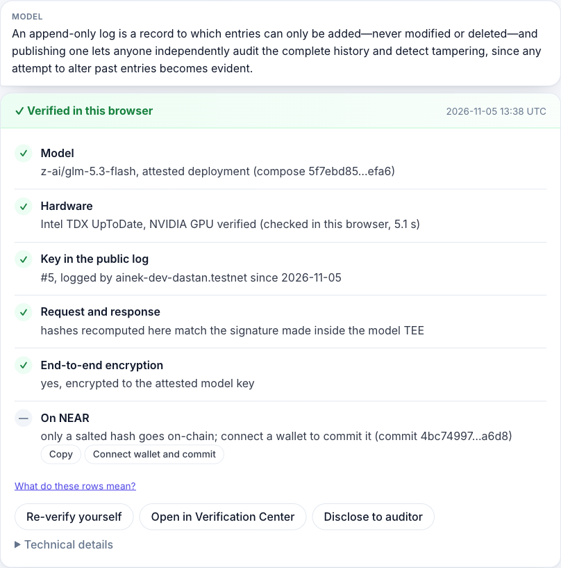
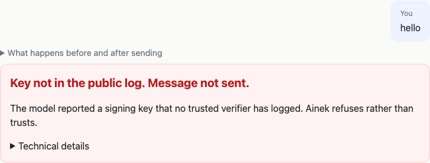

# Ainek — a public log of private-AI keys on NEAR, and agents that spend under a signed policy

> NEAR Hackathon submission (Nov 1–14, 2026). Tracks: **Privacy & Private AI** (messages encrypted end to end to an
> attested key; of a conversation, at most a salted hash goes on chain), **AI Security & Defense** (the client refuses
> before sending to a key nobody you trust has logged; the agent pays only under a signed policy), **Open Innovation**
> (a public key log for private AI, after Certificate Transparency).

<!-- TODO before submission: 90-second video link here. -->

A private model on NEAR AI Cloud answers from inside a TEE, a sealed environment the hardware vouches for, and signs
each answer with a key bound to it. The hardware proves that the enclave is genuine. It does not prove that you are
shown the same key as everyone else, or which code runs behind that key. On the replica that answered us (NEAR AI runs
several copies of the model), the enclave's own record shows **five builds of the proxy that decrypts prompts in three
weeks, behind one unchanged signing key**. [Brave](https://brave.com/blog/browser-ai-e2ee/), which builds on NEAR AI,
wrote on Oct 15, 2026 that there is "no public log of TEE keys yet".

**Ainek is a public, append-only log of those keys in a NEAR contract, and a client that sends nothing to a key the
verifiers you chose did not log.** The idea is borrowed from Certificate Transparency for web certificates; unlike
there, the writers here are not independent yet. A verifier checks the hardware evidence and writes down the key and
the launcher behind it (the boot configuration the hardware measures). A key or a launcher nobody you trust has logged
is refused before a message leaves. A message that does leave is encrypted end to end to that key, so our server cannot
read it; prompts and answers never go on chain, only a salted hash of a proof when you commit one. Verifiers also
record the release that serves the model, down to a source commit; refusing a release nobody recorded is off by
default, and one switch in the chat turns it on for you.

**For agents that spend:** the agent's key can propose a payment, not make one. A private policy (a whitelist, caps,
a threshold above which a person decides) runs inside Intel TDX on OutLayer, a service that runs jobs in enclaves for
NEAR contracts, and signs its decision. The contract checks that signature, then pays, refuses or waits for the owner,
and a stop button deletes the agent's key.

| The key is in the log: an answer with a proof you can re-check | The key is not: nothing is sent |
| --- | --- |
|  |  |

**Checked, not asserted.** 15 changes to recorded evidence are each refused for their own reason
(`pnpm demo:controls`). 50 of 50 live runs verified on Nov 13 ([docs/METRICS.md](docs/METRICS.md)). In the 76
repositories read for our survey of this hackathon's field we did not find, as far as the readings go, an append-only
key log for several verifiers with the choice of whom to trust left to the viewer
([docs/PRIOR-ART.md](docs/PRIOR-ART.md)).

**Limits, up front.** Testnet, not audited, and we can still replace the contract (its account has a full-access key).
Three verifiers write to the log: two are ours, and the third is run by a friend of ours, with his own key, from his
own GitHub account. His entries name the same key and launchers as ours. More under [Limits](#limits).

**Reviewing this?** Every claim, the code behind it and a command that shows it: [docs/REVIEW.md](docs/REVIEW.md).

## Run it (do X → see Y)

**In a browser**, at https://ainek.vercel.app (testnet). No key, no wallet.

| Do | See |
| --- | --- |
| Open the [chat](https://ainek.vercel.app) and click "Ask a private question" | An answer and its proof card, "Verified in this browser" (the picture above): the model, the hardware checks, the key's entry in the public log, the hashes, end-to-end encryption. "Re-verify yourself" runs the checks again in your browser |
| Open [`/?tamper=1`](https://ainek.vercel.app/?tamper=1) and send any message | The client is shown a swapped key and refuses: the red card "Key not in the public log. Message not sent." |
| Open [`/log`](https://ainek.vercel.app/log), "Who you trust" | The public key log, read from the NEAR contract, and your own choice of which verifiers count: untick the trusted one and the page says "Nobody is selected, so the chat refuses every message." |
| On [`/log`](https://ainek.vercel.app/log), "The code behind the key" → "Check the release" | The release that serves the model now, followed to a source commit, and under it the releases in that replica's action log (its own record of what was deployed in it): the kind of record the finding at the top was read from. Your browser asks GitHub and Sigstore, so it starts only when you click |
| In the [chat](https://ainek.vercel.app) tick "Stricter: send only when a verifier you trust has marked this state of the enclave (the release rule)", send any message | The browser attests again for this message. You get an answer with its proof if a verifier you trust has marked the enclave's action log as it stands now, and the red card "Message not sent." if none has. Both are the client working: after each new release at NEAR AI it refuses until a verifier you trust has marked it. The video shows both, recorded on Nov 14 ([Limits](#limits)) |
| Open [`/agent`](https://ainek.vercel.app/agent), then action #4 | A real denial from testnet (5000 AINEK to a new vendor, nothing moved), re-checked in your browser. Click "Demo: change the verdict and re-check" and the signature check turns red |
| Open [`/auditor`](https://ainek.vercel.app/auditor) → "Use the sample file" → Check | "This disclosure checks out": one disclosed proof checked against its commit on NEAR, without the plaintext |

More in a browser: `/?tamper=deployment` keeps the real key and shows a launcher nobody logged → "Unknown deployment.
Message not sent."; the Incognito model in the chat (a NEAR AI model
with no enclave) → the red card "This answer went through a non-attested model";
"Re-verify yourself" on a proof card, or a disclosure file pasted into `/verify`, re-checks a proof in your browser.
Every step with all it shows: [docs/DETAILS.md](docs/DETAILS.md#in-a-browser-step-by-step).

The hosted chat runs on our NEAR AI key, which has a spend limit and a rate limit. If it stops answering, everything
except sending a message still works, `pnpm demo` replays a recorded exchange offline, and the chat runs locally with
your key. If it refuses with no `?tamper` in the address, `/log` says why: the client refuses when no verifier you
trust has logged the key in the last 24 hours.

**From a clean clone.** Node 24 or newer and pnpm 10 (`corepack enable`; `nvm use` reads the repo's `.nvmrc`; the
root `pnpm` commands say so themselves when Node is older).

```bash
git clone https://github.com/sadabaevb/ainek && cd ainek && pnpm i

# offline, no key, a few seconds each
pnpm demo            # recorded TDX + GPU evidence and two signed exchanges, re-verified → "Result: VERIFIED"
pnpm demo:tamper     # the same recording with the key swapped → "Result: REFUSED", nothing is sent
pnpm demo:controls   # 15 changes to that evidence → "Result: REFUSED. 15 of 15 changes were refused, each for its own reason."
pnpm demo:policy     # recorded runs of the agent's policy in Intel TDX, re-checked → "Result: VERIFIED"
pnpm test            # the proof package, the recorded samples end to end, the on-chain entry #0 hash reproduced

# the network, no key
pnpm demo:attest     # 10 to 40 s: the model's evidence fetched now and verified here, its key and launcher looked up
                     #   in the log, then the release behind the key, down to a source commit → "Result: WOULD SEND".
                     #   Nothing is sent. If Intel's service does not answer it ends "NOT CHECKED": run it again.
                     #   --history adds every release in that replica's action log (one GitHub request each)
pnpm demo:log        # a few seconds: every hash of the log's chain recomputed and compared with places of the log recorded
                     #   in this repository → "Result: the chain holds from #0 to #…, and all 4 places seen earlier
                     #   are still in it."
pnpm -F verifier dry-run  # up to 90 s: the entries a registered verifier would append, one for each attested
                     #   launcher; sends nothing. Ends in
                     #   `quote.collateral_unavailable` when Intel's service does not answer: run it again

# with NEARAI_API_KEY in .env (cp .env.example .env; cloud.near.ai → API Keys)
pnpm demo:live       # the same checks live from Node, one encrypted request, the proof card
pnpm demo:reply-key  # a negative control: a hop swaps the reply key in transit and must get no reply
pnpm -F web dev      # http://localhost:3000; everything before a message works without the key
```

Every command with its flags and what it needs: [docs/DETAILS.md](docs/DETAILS.md#the-commands-in-full). Rust is
needed only for the two contracts and `jobs/policy`.

## What it checks

Three questions, each answered by something you can run. The first two are Tier 1 in this repository's terms, the
third is Tier 2.

1. **Is this key real?** The model's key and its launcher must be in the log, written by a verifier you trust; the
   client checks the same Intel TDX and NVIDIA evidence itself. If they are not there, nothing is sent. Which verifiers
   count, and how many must agree, is your choice on `/log`. `pnpm demo:tamper`, `pnpm demo:attest`, `pnpm demo:log`.
2. **Did this answer come from there?** The message is encrypted to that key. The signed answer is checked in the
   browser against the exact bytes, and a salted hash of the proof can be committed to NEAR. Prompts and answers never
   go on chain. `pnpm demo`, `/verify`, `/auditor`.
3. **Did the agent do only what it was allowed to?** The policy is private: the chain shows its hash, the proposed
   action and the signed decision, never its contents. The decision key is generated inside the enclave. The contract
   checks which key signed, not which build of the policy ran.
   `pnpm demo:policy`, `/agent`; what ran on testnet and what has not is in
   [docs/DETAILS.md](docs/DETAILS.md#the-agent-half-tier-2).

The finding on the first screen, its method and how the log records a release: [docs/RELEASE.md](docs/RELEASE.md).
Each question at full length, with screenshots: [docs/DETAILS.md](docs/DETAILS.md).

## How NEAR is used

- **NEAR AI Cloud** serves the private model, its attestation, its signatures and the end-to-end encryption. The SDK is
  used as it is, in the browser.
- **A NEAR contract**, [`ainek-log-dastan.testnet`](https://testnet.nearblocks.io/address/ainek-log-dastan.testnet),
  holds the key log (hash-chained, `log_key` only appends), the salted commits of proofs, and the
  agent's actions with their signed decisions.
- **NEAR accounts and function-call keys** keep each writer narrow: a verifier needs only a key for `log_key`, the
  agent's key can only propose an action and commit a proof hash, and the browser asks the wallet for one limited to
  `commit_proof`.
- **OutLayer**, which runs jobs inside Intel TDX for NEAR contracts, runs the agent's policy and signs the decision
  with a key generated there.

What NEAR provides and what Ainek adds, layer by layer: [docs/DETAILS.md](docs/DETAILS.md#how-near-is-used). Who can see
what: [docs/DETAILS.md](docs/DETAILS.md#who-sees-what), also on `/trust`.

## Limits

What to know before trusting any of this. There are 26 in all, each with its reason, in
[docs/CLAIMS.md](docs/CLAIMS.md#we-do-not-claim); these five matter most.

- **Testnet, not audited, and we can replace the contract.** The contract account still has a full-access key.
- **The verifiers are not independent.** Two of the three are ours. The third is run by a friend of ours from his own
  GitHub account ([docs/DEPLOY.md](docs/DEPLOY.md)). The site trusts one of ours by default; you can change that on `/log`.
- **A log entry is not a review.** A verifier writes down what attests. Its mark for a release says "followed to
  public sources", not "approved".
- **The client does not refuse on the release by default.** The chat acts on a release only if the visitor ticks the
  box, because the marks do not keep up with releases yet. On Nov 13 a new release waited five and a half hours for its
  first mark, and the site's default verifier wrote none for almost 32 hours, until Nov 14, 08:13 UTC. With the box
  ticked, the chat found no mark from a trusted verifier and refused that morning; it answered at 09:28 UTC, when the
  marks were back ([docs/RELEASE.md](docs/RELEASE.md)).
- **The deployment is attested, the model is not verified.** Weights are not checked, what the enclave keeps cannot be
  proven, and the page is served by our server.

## Status

As of Nov 14, 2026.

- **The key log and the client run end to end** on testnet and on the hosted demo: the contract
  `ainek-log-dastan.testnet`, the chat with its proof card, `/verify`, `/log`, `/auditor`. Three verifiers write to the
  log, and the entries of the one we do not operate name the same key and launchers for the model as ours do.
- **The agent is on testnet:** twelve actions, all proposed by us. Seven came from the agent service with a real model
  answer, six of them through a Telegram bot on Nov 7 and 11
  ([docs/DETAILS.md](docs/DETAILS.md#the-agent-half-tier-2)).
- **Not there:** a verifier run by someone we do not know; release marks that keep up with each new release, so that
  the release rule could be on for everyone; mainnet. Next: a verifier anyone can run in one command, open verifier
  registration in the next contract, a second provider in the same log
  ([docs/DETAILS.md](docs/DETAILS.md#next-steps)).

## Where to read more

- [docs/DETAILS.md](docs/DETAILS.md): the long version. Why, what you will see, how NEAR is used, every command, the
  agent half, who sees what, the architecture, next steps.
- [docs/CLAIMS.md](docs/CLAIMS.md): what we claim and what we do not.
- [docs/REVIEW.md](docs/REVIEW.md): every claim, the code behind it and a command that shows it.
- [docs/RELEASE.md](docs/RELEASE.md): the code behind a key, the method and what we measured.
- [docs/METRICS.md](docs/METRICS.md): 50 live runs on Nov 13 (a median of 9.8 s for a whole run), long conversations,
  long input, slow answers.
- [docs/PRIOR-ART.md](docs/PRIOR-ART.md): the neighbours in this hackathon and outside it, and where they are ahead.
- [docs/SPEC.md](docs/SPEC.md) (interfaces, in Russian), [docs/DEPLOY.md](docs/DEPLOY.md) (what is deployed where),
  [docs/ASSESSMENT.md](docs/ASSESSMENT.md) (the client against the six obligations of Private Inference Beat, an
  independent registry of private-inference providers).

## Repository

```
apps/web/            Next.js app: chat with the proof card, /verify, /log, /auditor, /agent, /trust; byte-exact relay to NEAR AI
apps/demo/           Node 24 CLI: pnpm demo (offline replay), demo:tamper, demo:controls, demo:policy, demo:attest, demo:log, demo:live, demo:reply-key, demo:metrics, record / check-contract / check-agent scripts
packages/proof/      shared TS: proof schema, canonical JSON, hashing, signatures, fail-closed rule, chain checks, tests
packages/tier1-node/ shared TS for Node: the Tier-1 sequence (attest, log check, E2EE request, signature, proof) used by
                     demo:live, demo:metrics and the Tier 2 agent service, and up to the send, with no key, by demo:attest;
                     mirrors apps/web/lib/flow.ts
contracts/ainek/     Rust near-sdk-rs contract: the key log, the proof commits, the agent's actions and decisions
                     (the methods are in docs/SPEC.md §4)
contracts/demo-token/ plain NEP-141 token (near-contract-standards) for the Tier 2 demo and the sandbox test
jobs/policy/         Rust OutLayer WASI-P1 job: evaluates the owner's policy, signs the decision (SPEC §6; Tier 2)
services/verifier/   daemon: attestation report → SDK checks → KeyEntry → log_key (`pnpm -F verifier start`, Dockerfile)
services/agent/      NL → NEAR AI → OutLayer → contract, Telegram bot, stop command (Tier 2): tested against fakes,
                     run on testnet through the bot on Nov 7 and 11 (docs/DETAILS.md, "The agent half")
docs/                see "Where to read more" above; samples/ (recorded evidence), test-vectors/
```

Tests:

- `pnpm test`, `pnpm typecheck`: TypeScript (node:test) in `packages/proof`, `packages/tier1-node`, `services/verifier`, `services/agent`, `apps/web`, `apps/demo`
- `contracts/ainek`: `cargo near build non-reproducible-wasm` builds it; `cargo test` runs unit tests and a `near-sandbox` integration test
- `jobs/policy`: `cargo test`
- `pnpm -F demo check-contract`: the deployed contract's ABI against SPEC §4.1, the hash of every entry included
- `pnpm -F demo check-agent`: the agent's keys, funds and recorded decisions on chain

## Disclosures

- Libraries: `@nearai/inference-sdk` 0.3.0 (attestation and signature verification, E2EE), `@hot-labs/near-connect` +
  `near-connect-hooks` (wallet), `near-api-js` 7 (the verifier's and the agent's transactions, RPC error types, unit
  conversion), `zod` (schemas), `tweetnacl` (ed25519), `ethers` (sha256, EIP-191 recovery for ecdsa signatures), `yaml`
  (compose files), `grammy` (the Telegram bot), `@phala/dcap-qvl` (checks the TDX quote of a policy run; with `jose`,
  offline replay of Intel and NVIDIA evidence), Next.js 16 / React 19, the IBM Plex fonts (Sans, Serif, Mono)
  self-hosted under `apps/web/public/fonts`, copied from `@fontsource/ibm-plex-*` 5.3.0 (SIL OFL 1.1, licences
  alongside). Rust: `near-sdk` 5 and `hex` (the contract), `near-contract-standards` 5 (the demo token), `ed25519-dalek`
  and `sha2` (the policy job's signature), `serde`, `serde_json`, `bs58`, `base64` (the policy job), `cargo-near`,
  `near-sandbox`, `near-api`, `cargo-near-build`, `tokio`, `testresult` (builds and tests).
- Copied pattern: `contracts/demo-token/src/lib.rs` wires up `near-contract-standards` the way the official
  `near-examples/FT` example does (the token logic itself is that library).
- Read at run time, with no code copied: Countersign's feed contract on NEAR testnet, Quill Cloud's policy file and
  teemoon's review pages on GitHub ("Who else has looked at exactly this" in `docs/RELEASE.md`). Two feed entries, two pins and the first lines
  of one review page are recorded under `docs/samples/outside` for the tests.
- Reference material followed (no other code copied so far; a file that copies code will say so): the `@nearai/inference-sdk`
  verification guide, `near-examples/nearai-cloud-verification-example`, `nearai/nearai-cloud-verifier`,
  `out-layer/private-dao-example` (Tier 2).
- AI-generated code: substantial parts were written with Claude Code and reviewed by the team; the TypeScript branches went
  through `/simplify` and `/code-review` before merge; see the commit history and `docs/DEV-NOTES.md`. The video was
  also put together by the agent, from recordings of the hosted site, and its voice is synthetic
  ([docs/DEMO-SCRIPT.md](docs/DEMO-SCRIPT.md)).
- Hackathon window: all code after tag `pre-hackathon` (project kit: docs, spec, prompts, no code; Nov 2 2026). Diff:
  [`pre-hackathon...hackathon-submission`](https://github.com/sadabaevb/ainek/compare/pre-hackathon...hackathon-submission).
- Other projects by the same people in this hackathon: Ainek is the one we build together. Each of us also submits one
  project of his own, built apart from this one: [NearBy](https://github.com/dastansam/nearby) (Dastan) and ushak (Bektur).
  <!-- TODO before submission: push the tag `hackathon-submission` (the compare link above needs it); the link for ushak; check that both links open without a login; drop any not submitted -->

## License

MIT — see [LICENSE](./LICENSE).
