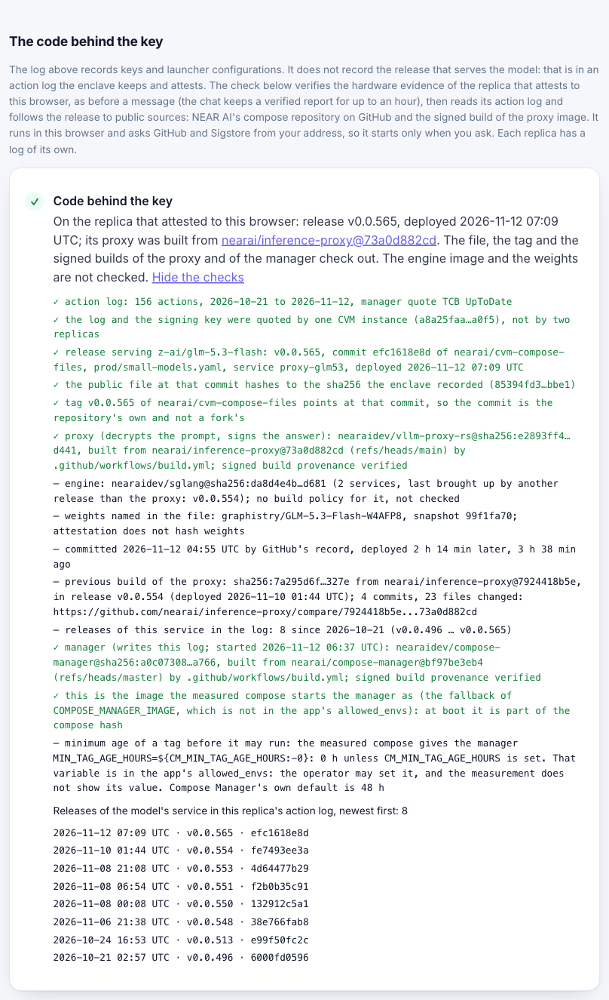

# The code behind the key

What stands behind a model's signing key on NEAR AI Cloud, how Ainek follows it to a source commit, what the key log
records about it, and what we measured. Moved here from the README on Nov 13, 2026, with pointers adjusted. The limits named
"What we do not claim" are in [CLAIMS.md](CLAIMS.md); the README names the five that matter most under [Limits](../README.md#limits).

One signing key can stand in front of many versions of the code. On NEAR AI Cloud the hash an enclave measures at boot
covers a launcher; the containers that serve the model are deployed afterwards, and the enclave records each deployment in
an action log it attests. `pnpm demo:attest` reads that log, with no key and no spend, and follows the release that serves
the model to a source commit:

| Step | What is checked |
| --- | --- |
| Action log | authenticated by the SDK against a TDX quote of its own; that quote and the one behind the signing key name the same CVM instance, so the log is this replica's |
| Release | the latest `compose_up` for the model's service: tag, commit, file and its sha256 |
| File | the file at that commit in the public repository `nearai/cvm-compose-files` hashes to the recorded sha256 |
| Tag | the repository's tag of the recorded name points at that commit; a tag the repository does not have fails. A commit id alone could be a fork's: GitHub serves those under the parent's name |
| Proxy image | pinned by digest in the file; its signed build provenance (Sigstore, GitHub Actions) names the repository, branch and commit |
| Manager image | the same provenance check for Compose Manager, which writes the log, and a comparison with the image the measured compose starts it as |
| Engine and weights | printed as the file of the engine's own latest release names them; not checked |

A check has three outcomes, and the command keeps them apart: it held, it failed, or it could not be made. GitHub saying
"no such tag, file or build proof" fails the check; GitHub not answering leaves it not made. The summary line gets a check
mark only when every check of the release was made and held.

What that log held on the CVM that answered us on Nov 12, 2026 (`pnpm demo:attest --history` prints it for the CVM that
answers you):

- **21 releases of the model's compose file since Oct 21.** A commit first ran in the enclave a median of 12 minutes after
  it was made; the shortest was 46 seconds, and 17 of 21 took under an hour. Compose Manager can refuse a tag younger
  than a set age, 48 hours by its own default. The measured compose of that CVM sets it to `${CM_MIN_TAG_AGE_HOURS:-0}`:
  zero unless the operator's environment says otherwise, and that value is not measured.
- **Five images of the proxy that decrypts prompts for `z-ai/glm-5.3-flash` ran there in turn** (from Oct 21, Oct 24,
  Nov 6, Nov 8 and Nov 12; the log opens with the first, so the image changed four times), each build with valid
  provenance from `nearai/inference-proxy`. The signing key did not change.
- **Our deployment check did not see it.** It compares the launcher's compose hash. After that CVM's hash first appeared
  in our log (Nov 8, 11:20 UTC) the proxy changed twice, and the client would have refused neither.
- **Each replica has a log of its own.** The same command three hours later was answered by another replica (launcher
  `c900dc73…e2d0`): 271 actions since Sep 11, the model served from another compose file, by a release deployed 26
  minutes earlier.

The evidence is NEAR AI's own and public by design: the action log, the compose repository and the signed builds are
theirs, and the SDK can authenticate them. We are not the first to read them. Brave's near-verifier, Quill Cloud,
AnonRouter and the Hermes confidential-mode plugin each follow this log for their own gateway or user, and all but
AnonRouter can refuse a release they have not approved. Brave's README, its gateway's attestation check and Quill's
review of Nov 12 we opened ourselves; the other two are as a delegated reader reported. In this hackathon Countersign,
Neslos and DNA Confidential read it too ([PRIOR-ART.md](PRIOR-ART.md)). We add two things: a client that reads
them in a browser and from a clean clone, and marks in a public log on NEAR, below, which several verifiers can write
and a client can choose among (today two of the three verifiers are ours and the third is a friend's, and a mark is not an approval). The log is a record, not a
measurement: a release leaves the enclave's measurements as they were, and the log is as good as the code that has run
in that CVM. That limit and the others are under "What we do not claim"; the method is in `docs/DEV-NOTES.md`
(Nov 12).

The same chain runs in the browser, on request: the proof card has a line "Code behind the key" with a button, and `/log`
has a section of the same name that also lists the releases in the replica's log. The check asks GitHub and Sigstore
from the visitor's own address, so it never starts by itself. It shows the release; the client does not refuse on it.

## Who else has looked at exactly this

Two of the three verifiers that write to our log are ours, and the third is run by a friend. Other people check NEAR AI too, and three of them publish what they found
under the same values the enclave attests: [Countersign](https://github.com/greenlima/sealed-review) (a reviewer's signed
feed in a NEAR testnet contract, another entry in this hackathon), [Quill Cloud](https://github.com/Lore-Hex/quill-cloud-proxy)
(a gateway's public policy file) and [teemoon audits](https://github.com/teemoonai/audits) (source reviews by the hash
of a release file). `pnpm demo:attest` and the release check in the browser read the three and mark each "seen", "not
seen" or "not known". "Seen" is not approval: on Nov 13 Countersign had seen the key and the launcher we use, and its
verdict was "warning"; none of the three had looked at the release that had gone live a few hours before. The readings
are shown and never applied, and a Countersign entry lasts three days, so its line may read "expired". What a reading
says and does not say is in [CLAIMS.md](CLAIMS.md); the sources are in [SPEC.md](SPEC.md) §7.6.



## The release in the key log

Reading a release is not refusing one. Since Nov 12 both ends of a rule exist, and the rule is off by default.

- **The verifier writes what it checked.** After a key verifies, the verifier follows the release behind it with the same
  chain. When every check holds, the entry it logs carries two marks next to the launcher's image digests: the enclave's
  action log as it stood (instance, number of actions, hash) and the release of the model's service. The contract did not
  change: that field takes text, and a client that does not know the marks ignores them.
- **The client can refuse** (`AINEK_REQUIRE_RELEASE=1`). The action log the enclave attests must be exactly one that a
  quorum of the viewer's verifiers marked. An enclave deploys by adding to that log, so whatever it did after a verifier
  looked is refused until a verifier looks again: a release of the model's file, a deployment from another file, a restart
  of its manager. A log that no longer begins with what a verifier saw from the same instance is refused as rewritten.
  The rule needs no network: the log comes with the attestation the client has already verified. It speaks for the moment
  of that attestation, so with the rule on the browser attests again for every message instead of reusing one for an hour.
- **The client can wait** (`AINEK_RELEASE_WAIT_MIN`, no wait by default). On the CVM we looked at, a commit first ran
  in the enclave a median of 12 minutes after it was made. With a wait of, say, 60 minutes the client sends only when
  the action log has been marked as it stands for an hour, by as many verifiers as its quorum. Anything added to that log
  starts the wait again: a release, a deployment from another file, a new manager image. The wait is on the marks, so it
  says how long a state has been in the public log, not how long the code has existed.

```bash
pnpm -F verifier dry-run   # no account, sends nothing: the entry a verifier would log, with its two marks
pnpm demo:attest           # step 5 ends with where the key log stands on the action log of the replica that answers
```

`/log` shows that same line in the browser: under "The code behind the key", Check the release, then Show every check.
It reads the replica that attests to the browser at that moment and follows the trust set chosen on the page. For the
submission the rule is shown and not enforced; we switch it to refusing once the log keeps up with releases, and on
Nov 13 it did not (below).

The cost is refusals: after every action in an enclave, until a verifier has seen that replica again. On the two action
logs we hold (22 and 47 days) that is about two windows a day for each replica. The limits are the ones above and one
more. The action log is a record, so the rule holds an enclave to what its own record said. A mark means a verifier
followed the release that serves the model to public sources, not that anybody read the code, and not that the verifier
followed everything that log deployed: the log does not say which earlier services a later deployment replaced. The
first marks are in the log: entries #73 and #74 (Nov 12, 17:10 and 17:30 UTC), one from each verifier. With the rule
switched on, `pnpm demo:attest` then reported that it would send, for the one replica that answered. Quill Cloud's
public review of the same day pins the same instance at the same hash of its history and the same hash of the release
file ([PRIOR-ART.md](PRIOR-ART.md)); we learned of it on Nov 13.

The first measured window came the next night. On Nov 13 at 00:56 UTC release v0.0.581 of the model's file went live on
one replica, 38 minutes after its commit. The mark for that state came at 06:24 UTC, 5 hours 28 minutes later, and from
the second verifier only: GitHub ran its hourly schedule at 23:28 and next at 06:24. The verifier on our server, the
only one in the site's default trust set, wrote two entries after the release, neither with a mark; why its release
check did not pass we have not established (`docs/DEV-NOTES.md`, Nov 13). With the rule on, a client routed to that
replica would have refused all that time.
